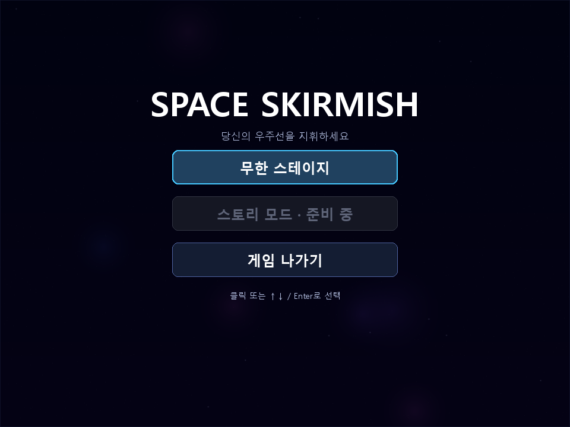
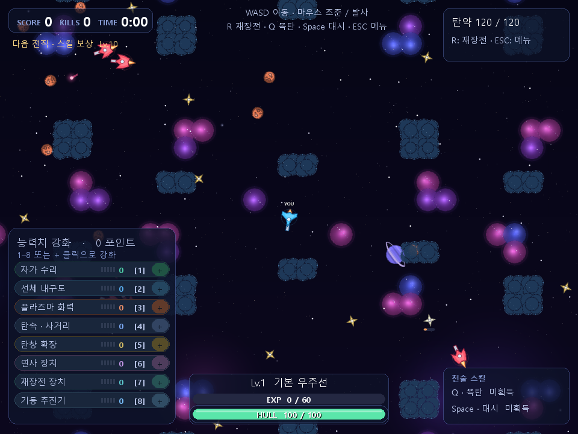
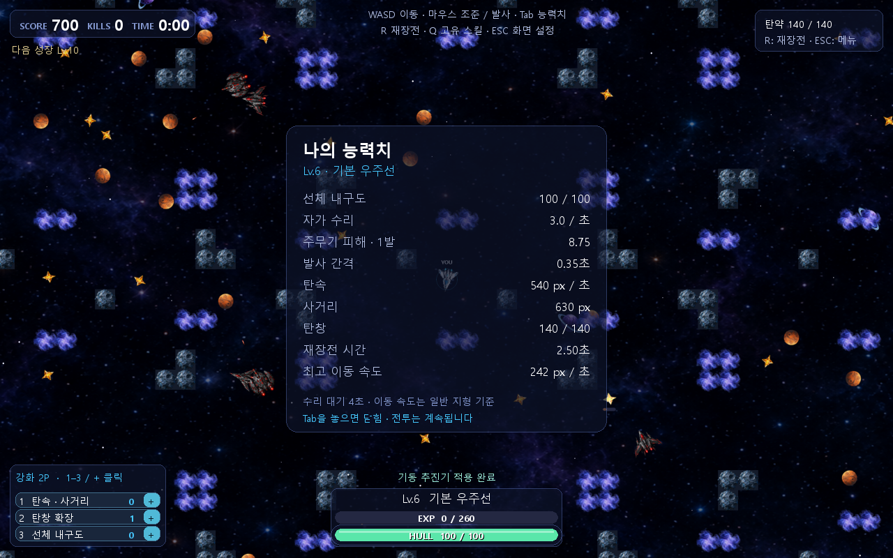
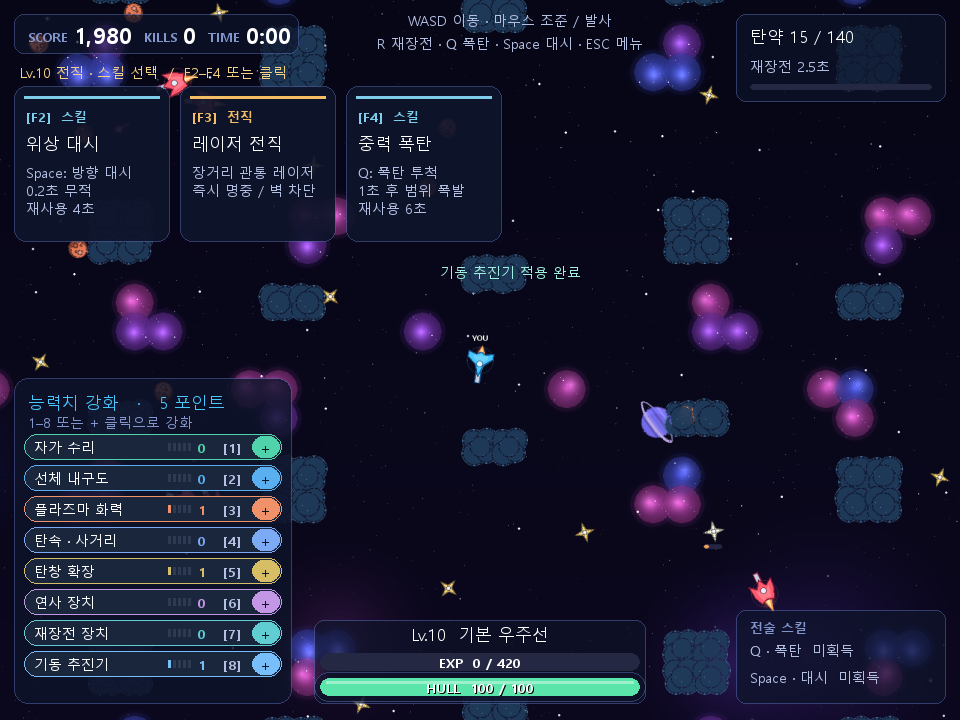
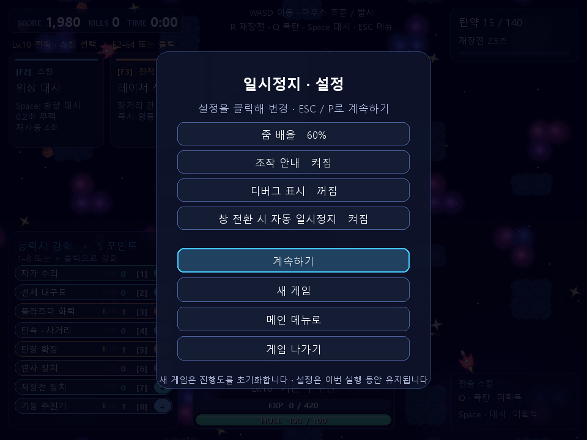
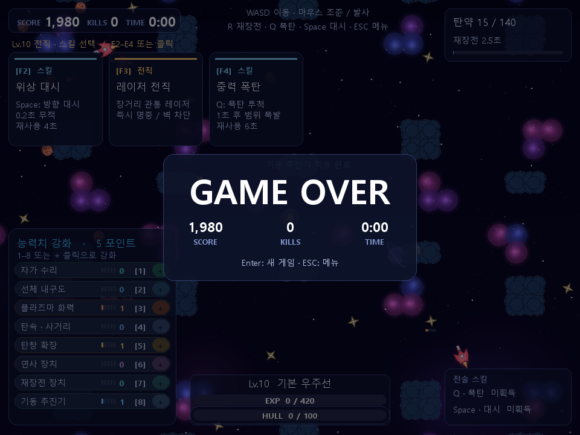

# 조작과 사용자 흐름

현재 게임은 **천체를 부수고 적과 싸우며 오래 생존하는 무한 전투**입니다. 스테이지 클리어나 스토리 진행은 없습니다. 아래 화면은 실제 게임 렌더러로 재현한 설명용 장면입니다.

## 먼저 조작법

| 입력 | 동작 | 적용되는 화면 |
|---|---|---|
| W / A / S / D | 위 / 왼쪽 / 아래 / 오른쪽 이동. 두 키로 대각선 이동 | 전투 |
| 마우스 이동 | 커서 방향으로 조준. 이동 방향과 독립적 | 전투 |
| 마우스 좌클릭 | 발사. 유지하면 발사 간격에 맞춰 연사 | 전투 |
| R | 2.5초 재장전 | 전투, 살아 있을 때 |
| 1–8 / 능력치 + 클릭 | 일반 강화 포인트 사용 | 전투의 좌하단 목록 |
| Tab 유지 | 현재 능력치 반투명 패널. 놓으면 바로 닫힘 | 전투 |
| F2 / F3 / F4 / 카드 클릭 | 전직·스킬 보상 선택 | 전투의 좌상단 카드 |
| Q / Space | 폭탄 / 대시 사용, 획득한 뒤 사용 가능 | 전투 |
| ESC / P | 설정 메뉴 열기 / 계속하기 | 전투·설정 |
| F1 | 디버그 표시 켜기 / 끄기 | 게임 화면 |
| N | 다음 맵으로 바꾸고 새 게임 | 게임 화면 |
| ↑ / ↓ / Tab | 메뉴의 활성 버튼 사이 이동 | 메인·설정 |
| Enter / Space | 선택된 메뉴 버튼 실행 | 메인·설정 |
| Enter | 새 게임 | 게임 오버 |
| Q | 게임 종료 | 설정 메뉴 |
| 창 닫기 | 게임 종료 | 모든 화면 |

마우스 우클릭에는 현재 동작이 없습니다. 메뉴 버튼을 누른 클릭이 전투 발사로 이어지지 않도록, 다시 좌클릭하려면 버튼을 한 번 놓아야 합니다.

## 1. 시작: 메인 메뉴

**무한 스테이지**를 누르면 새 판을 시작합니다. **스토리 모드**는 비활성이고 눌러도 진행하지 않습니다. **게임 나가기**는 프로그램을 종료합니다. 방향키로 이동할 때도 비활성 스토리 버튼은 건너뜁니다.

처음 시작은 기본 `drift` 맵입니다. 실행 명령에서 맵이나 지형 옵션을 지정했다면 그 조건으로 시작합니다.

## 2. 전투: 이동하고 조준하고 발사

WASD로 이동하면서 마우스로 다른 방향을 쏠 수 있습니다. 이동 키를 놓으면 관성으로 감속합니다. 화면 밖에서도 적과 천체는 움직이며, 카메라는 플레이어를 따라갑니다.

HUD에서 보는 정보는 다음과 같습니다.

| 위치 | 정보 |
|---|---|
| 왼쪽 위 | 점수, 적 처치 수, 게임 시간 |
| 점수 아래 | Lv.10·20…의 전직·스킬 선택 카드 3개. 없으면 다음 보상 레벨 |
| 오른쪽 위 | 남은 탄창 / 최대 탄창, 재장전 남은 시간과 진행 바 |
| 아래 가운데 | 레벨·우주선 이름, 경험치와 체력 2줄 |
| 왼쪽 아래 | 강화 포인트가 있을 때만 일반 능력치 8개, 강화 횟수, 남은 포인트, + 버튼 |
| 오른쪽 아래 | 폭탄·대시 획득 여부와 남은 재사용 시간 |
| 화면 위 | 조작 안내. 설정에서 끌 수 있음 |

강화 포인트와 전직 카드는 사용할 때까지 남습니다. 선택을 마친 보상 이름은 게임 시간 기준 약 3초 표시됩니다.

현재 능력치는 **Tab을 꾹 누르는 동안** 확인합니다. 키를 놓으면 바로 사라집니다. 체력·회복·화력·연사·탄속·사거리·탄창·재장전·이동 속도를 보여주며, 전직과 강화도 수치에 반영합니다. 패널을 보는 동안에도 이동·발사와 전투가 계속됩니다.

## 3. 탄약이 줄면 재장전

`R`은 기본 **2.5초 후 최대 탄창까지 보충**합니다. 기본 용량은 120발이며 탄창 강화로 늘릴 수 있습니다. 재장전 강화는 시간을 줄입니다. 예비 탄약·횟수 제한은 없고, 이동·조준은 가능하지만 주무기 발사는 막힙니다. 폭탄·대시는 별도 스킬입니다.

탄창이 이미 가득 찼거나 재장전 중이면 R을 눌러도 새 재장전을 시작하지 않습니다. 상세 규칙은 [전투와 재장전](02-combat-and-reload.md)에 있습니다.

## 4. 일반 강화와 전직 보상

일반 레벨업은 강화 포인트 1개를 주고 좌하단 목록이 나타납니다. `1–8` 또는 행의 `+`를 눌러 능력치를 올립니다. 포인트를 모두 사용하면 목록이 사라집니다. 미사용 포인트가 있으면 선택할 때까지 유지됩니다. L 카드 창은 없습니다. 목록에 마우스를 올리면 강화 효과를 볼 수 있습니다. 제한에 도달한 연사·재장전은 포인트를 쓰지 않습니다.

Lv.10·20·30…에는 일반 포인트 대신 전직·스킬 카드 3개가 자동으로 나타납니다. `F2–F4` 또는 클릭으로 하나를 선택합니다. 남은 선택권이 있으면 다음 세 장이 바로 나타납니다. 전직 카드를 선택하지 않아도 일반 포인트를 사용할 수 있습니다.

두 보상 모두 전투를 멈추지 않습니다. 안전하게 선택하고 싶으면 위치를 확보하거나 ESC로 잠시 정리한 뒤 돌아오면 됩니다. 메뉴를 열어도 카드가 다시 추첨되지 않습니다. 위 장면은 Lv.6/Lv.10 상태를 재현한 것입니다. [전체 보상](03-rewards.md)을 확인할 수 있습니다.

## 5. ESC: 일시정지와 설정

게임 중 `ESC` 또는 `P`를 누르면 설정 메뉴가 열립니다. 게임·회복·재장전·스킬 시간이 멈춥니다. 계속하기로 돌아오면 보상과 강화 포인트가 유지됩니다.

| 설정 | 기본 | 바뀌는 것 |
|---|---|---|
| 줌 배율 | 60% | 클릭할 때 75 → 100 → 45 → 60% 순환. 작은 값일수록 넓게 보임 |
| 조작 안내 | 켜짐 | 화면 아래 단축키 안내 표시 |
| 디버그 표시 | 꺼짐 | 관찰값, 적 경로·목표·플레이어 감지선 표시 |
| 창 전환 시 자동 일시정지 | 켜짐 | 창 포커스를 잃으면 설정 메뉴가 열림. 끄면 전투가 계속됨 |

**계속하기**는 현재 판으로 돌아갑니다. **새 게임**은 현재 맵에서 진행도를 초기화합니다. **메인 메뉴로** 돌아간 뒤 무한 스테이지를 다시 누르면 새 판을 시작합니다. **게임 나가기**는 종료입니다.

설정은 즉시 적용되고 같은 실행 안에서는 새 판에도 유지됩니다. 프로그램을 종료했다 켜면 기본값으로 돌아갑니다. 세이브 파일이나 설정 저장 파일은 없습니다.

## 6. 사망: 게임 오버

체력이 0이 되면 전투가 멈추고 최종 점수·처치 수·생존 시간이 표시됩니다. `Enter`로 새 판을 시작하거나 `ESC`로 메뉴를 엽니다. 부활이나 이전 판 이어하기는 없습니다. `R`은 재장전 키이므로 게임 오버를 다시 시작하지 않습니다.

## 읽으면서 판단할 부분

보상을 HUD에서 실시간 선택하도록 바꿨습니다. 전직 선택 중 전투도 멈출지, 미사용 포인트를 더 강조할지, 맵 선택을 N 대신 메뉴로 옮길지 판단할 수 있습니다.

다음: [전투·체력·탄약·재장전 →](02-combat-and-reload.md) · [목차](../README.md)
