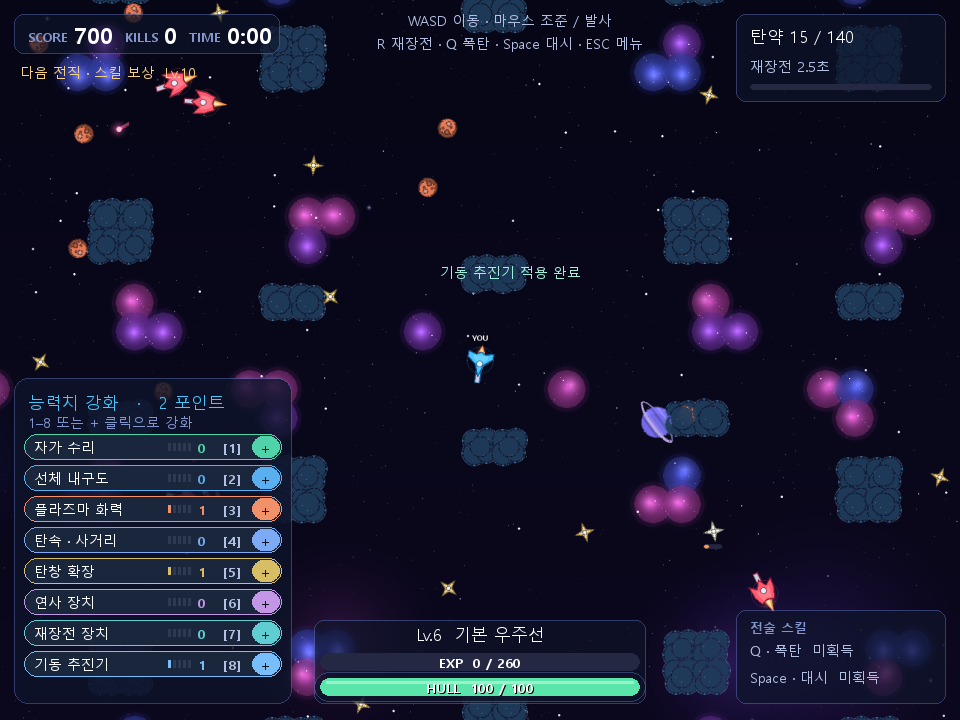

# 전투와 재장전

기본 체력 100, 탄창 120발, 예비 탄약 무제한, 재장전 2.5초입니다. 마지막 탄을 쓰면 자동 재장전하며, R로 남은 탄약이 있어도 수동 재장전을 시작할 수 있습니다. 점사의 마지막 후속탄을 썼을 때도 바로 자동 재장전합니다. 이동·조준은 가능하지만 재장전 중 발사는 멈춥니다. R을 다시 눌러도 타이머를 다시 시작하지 않습니다. 설정 메뉴에서는 게임 시간이 멈춥니다.

여러 탄을 동시에 쏘는 기체와 포신을 번갈아 연사하는 기체가 구분됩니다. 발사된 탄환마다 탄약 1발을 사용하며 잔탄이 부족하면 가능한 탄만 발사합니다. 연사 묶음의 후속탄은 실제 발사 프레임에 소모하고 재장전·전직·사망 시 취소됩니다.

레일거너와 하이퍼 레일건도 일반탄을 사용합니다. 장거리·고속·높은 피해로 차별화하며 처음 맞은 대상에 피해를 주고 사라집니다. 벽에서는 차단됩니다.

가디언 계열은 실제 선체 반경과 체력이 커지고 받는 피해가 줄지만 주무기는 작은 견제탄입니다. 전직해 선체가 커질 때 벽에 겹치면 들어갈 수 있는 가까운 위치로 보정합니다.

[성장과 진화](03-rewards.md) · [목차](../README.md)

헌터와 프레데터의 2/3연발 점사는 제거했습니다. 두 기체는 한 번의 공격으로 일반탄 1발만 발사하고, 나머지 기체의 기존 연사와 다방향 동시 사격은 유지합니다.

플레이어와 적의 선체와 충돌 반경을 직전 버전에서 30% 줄였습니다. 기본 반경 30.8px, 최종 시타델 67.2px이며 전직별 크기 비율은 유지합니다. 탄환 크기도 각 포신의 실측 입구 폭에 맞춰 함께 줄어듭니다. 탄환 PNG의 넓은 투명 여백은 표시 단계에서 보정합니다.
