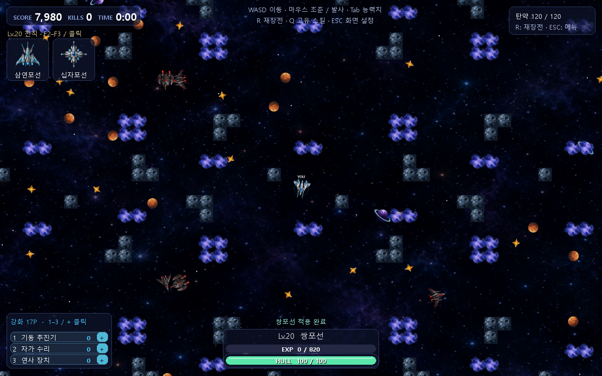
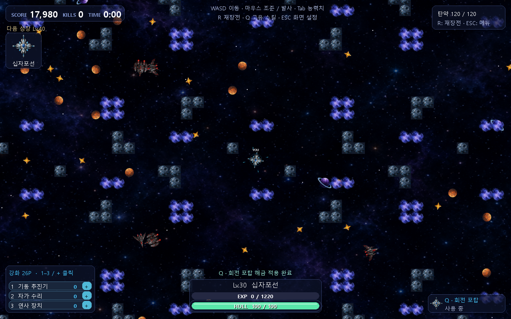

# 레벨업과 전직 트리

점수만큼 경험치를 얻습니다. 일반 레벨업은 능력치 포인트를 주고, **Lv.10 계열 선택 → Lv.20 진화 선택 → Lv.30 고유 스킬 해금**으로 성장합니다. 선택 중에도 전투는 계속됩니다.

## 경험치와 선택 순서

다음 레벨에 필요한 경험치는 `60 + (현재 레벨 - 1) × 40`입니다. 남은 경험치는 다음 레벨에 이어집니다.

| 도달 레벨 | 시작부터 누적 XP | 보상 |
|---|---|---|
| 2 | 60 | 일반 강화 1포인트 |
| 10 | 1980 | 4개 계열 중 선택. 이전 일반 포인트 총 8개 |
| 20 | 7980 | 해당 계열의 2개 진화 중 선택. 이전 일반 포인트 총 17개 |
| 30 | 17980 | 선택한 진화의 고유 스킬 자동 해금 |
| 40 | 31980 | 현재 최종 우주선 숙련 선택. 이후 매 10레벨 반복 |

큰 점수로 여러 구간을 넘겨도 Lv.10 선택부터 순서대로 진행합니다. Lv.20 진화를 늦게 골랐다면 선택 직후 Lv.30 스킬을 해금합니다. 전직은 일반 강화·남은 포인트·탄창을 유지합니다. 새 판에서는 모두 초기화합니다.

## 일반 강화: 8종 중 3개 표시

포인트가 있을 때만 좌하단에 작은 목록이 나타납니다. 무작위 3개를 `1–3` 또는 `+` 클릭으로 고릅니다. 선택하면 다음 3개가 갱신되고, 포인트를 모두 쓰면 목록이 사라집니다. 메뉴를 열거나 화면 크기를 바꿔도 현재 선택지가 재추첨되지 않습니다.

| 능력치 | 효과 | 제한 |
|---|---|---|
| 자가 수리 | 초당 회복 +1.5 | 피격 후 4초 대기 유지 |
| 선체 내구도 | 최대 / 현재 체력 +25 | 최대치까지 회복 |
| 플라즈마 화력 | 피해 ×1.25 | 주무기·스킬·돌격선 충돌 공격 |
| 탄속 · 사거리 | 탄속 ×1.2, 수명 ×1.15 | 레일건 사거리도 수명 배율 적용 |
| 탄창 확장 | 최대 / 현재 탄약 +20 | 재장전 중에도 새 최대 용량 적용 |
| 연사 장치 | 기본 발사 대기 ×0.85 | 기본 대기 최소 4프레임. 전직 배율은 별도 |
| 재장전 장치 | 시간 배율 ×0.9 | 최소 0.75초 |
| 기동 추진기 | 이동 가속도 ×1.15 | 일반 지형 최고 속도도 증가 |

제한에 도달한 연사·재장전은 다음 추첨에서 제외합니다. **Tab을 누르는 동안** 현재 전직·강화가 반영된 능력치를 볼 수 있습니다. 탄약 보급 카드는 없고 R로 재장전합니다.

## Lv.10과 Lv.20: 우주선 선택

카드는 좌상단에 **우주선 이미지와 이름만 담은 90×90px 정사각형**으로 표시합니다. 마우스를 올리면 효과를 설명합니다. Lv.10은 F2–F5, Lv.20은 F2–F3 또는 클릭으로 선택합니다.

| Lv.10 계열 | Lv.10 기본 특성 | Lv.20 선택 A | Lv.20 선택 B |
|---|---|---|---|
| 쌍포선 | 평행한 포 2개, 각 피해 ×0.8 | 삼연포선: 3방향, 각 피해 ×0.8 | 십자포선: 전후좌우 4방향, 각 피해 ×0.85 |
| 저격선 | 피해 ×2.5, 대기 ×1.7, 탄속 ×1.8 | 레일건선: 피해 ×3.5, 적 무제한 관통 | 기뢰선: 피해 ×3, 탄이 멈춰 접촉 기뢰가 됨 |
| 개틀링선 | 피해 ×0.6, 대기 ×0.35, 탄속 ×1.2 | 산탄선: 부채꼴 6발, 각 피해 ×0.65 | 유도탄선: 적을 향해 휘는 미사일, 피해 ×1.8 |
| 수호선 | 최대 / 현재 체력 +50, 받는 피해 -35% | 추진선: 전방 1발·후방 2발, 후방 포 반동으로 가속 | 돌격선: 포 없음, 충돌 피해 8배, 받는 피해 -65% |

다중 발사는 탄환마다 탄약을 씁니다. 남은 탄약이 적으면 남은 수만큼 발사합니다. 돌격선은 주무기 탄약을 쓰지 않습니다. 레일건은 여러 적과 천체를 한 번에 관통하지만 **벽에서는 차단**됩니다. 기뢰는 약 0.27초 이동 후 멈추고, 최대 약 8초 남으며 접촉·수명 종료·고유 스킬로 폭발합니다.

진화는 해당 계열의 다른 갈래로 다시 바꿀 수 없습니다. Lv.40부터는 현재 최종 진화의 숙련을 선택하며 기본 주무기 피해 배율에 0.2씩 더합니다(1 → 1.2 → 1.4).

## Lv.30: 고유 액티브 스킬

고유 스킬은 추가 선택 없이 자동으로 해금합니다. **Q**로 사용하며 탄약을 쓰지 않습니다. 워프 대시와 램 차지는 **Space**로도 사용합니다. 미획득 상태에서는 우하단 패널을 숨기고, 획득 후 이름과 남은 쿨다운만 작게 표시합니다.

| 진화 | 스킬 | 효과 | 재사용 |
|---|---|---|---|
| 삼연포선 | 전방위 탄막 | 주위 20방향 발사 | 8초 |
| 십자포선 | 회전 포탑 | 5초 동안 회전하는 4방향 포탑 | 10초 |
| 레일건선 | 차지 빔 | 0.75초 충전 후 주무기 피해 5배 빔 | 8초 |
| 기뢰선 | 일제 기폭 | 자신의 기뢰를 모두 폭발. 기뢰가 없으면 사용하지 않음 | 4초 |
| 산탄선 | 과부하 | 5초 동안 발사 대기 -60%, 피해 +30%. 주무기 탄약은 정상 소모 | 12초 |
| 유도탄선 | 미사일 일제사격 | 유도 미사일 8발 | 10초 |
| 추진선 | 워프 대시 | 0.18초 고속 이동·무적 | 5초 |
| 돌격선 | 램 차지 | 0.5초 돌진·무적, 충돌 피해 추가 4배 | 7초 |

대시는 WASD 방향이 우선이며, 정지 중에는 조준 방향을 사용합니다. 벽을 통과하지 않습니다. 기뢰 폭발은 중심에서 멀수록 피해가 줄며 자신에게 피해를 주지 않습니다. 폭발은 벽 뒤의 범위 안 대상에도 피해를 줍니다. 스킬은 재장전 중에도 쓸 수 있지만, 과부하는 재장전을 생략하지 않습니다.

스킬·충전·재장전 시간은 게임 프레임 기준이며 ESC 메뉴에서는 함께 멈춥니다. 현재 수치들은 첫 적용 기준이며, 각 갈래의 탄약 효율과 지속 전투 성능은 실제 플레이로 조정할 부분입니다.

정의와 배치: `progression.py`. 선택·발사·스킬 규칙: `game_core.py`. PNG 읽기와 변환 캐시: `sprite_assets.py`.

다음: [맵과 상호작용 →](04-maps.md) · [목차](../README.md)
