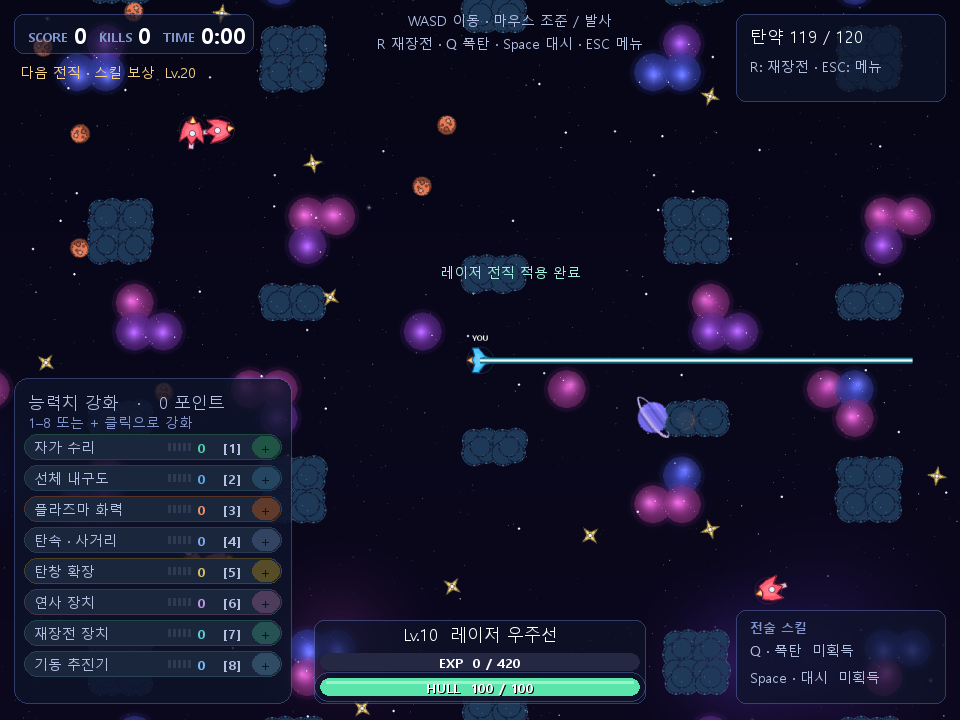
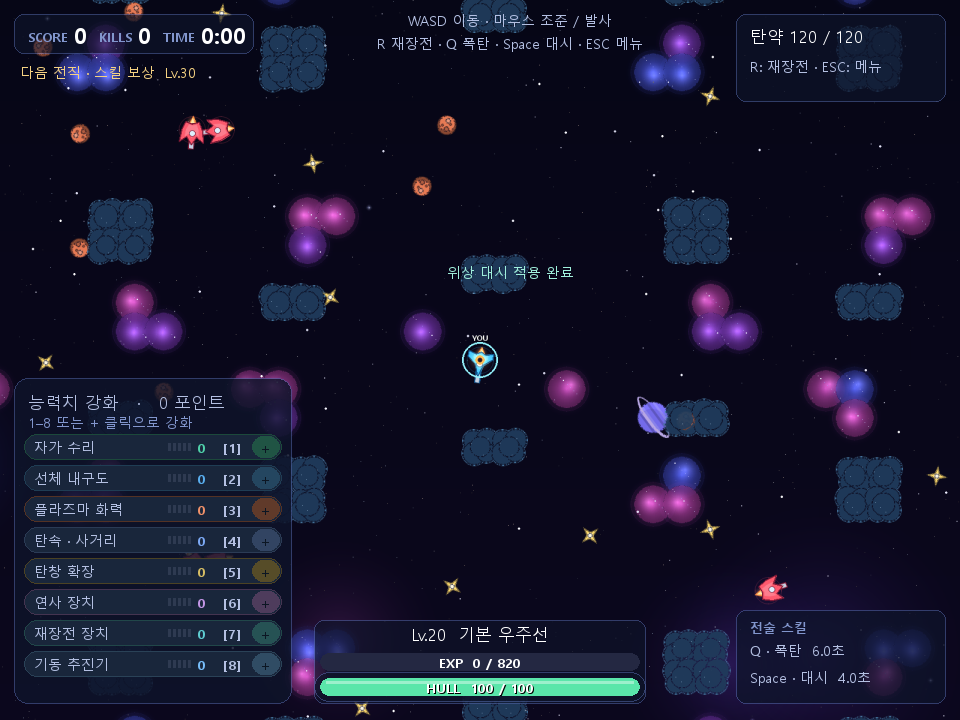

# 레벨업과 보상 카드

점수만큼 경험치를 얻습니다. **일반 레벨업은 능력치 포인트, Lv.10·20·30…은 전직·스킬 선택권**을 받습니다. 강화와 선택은 HUD에서 바로 처리하며 전투가 계속됩니다. 레벨만 올려서는 능력치가 자동으로 늘지 않습니다.

## 경험치와 선택권

다음 레벨에 필요한 경험치는 `60 + (현재 레벨 - 1) × 40`입니다. 필요한 양을 빼고 남은 경험치는 다음 레벨에 이어집니다.

| 도달 레벨 | 직전 레벨에서 필요한 XP | 시작부터 누적 XP |
|---|---|---|
| 2 | 60 | 60 |
| 3 | 100 | 160 |
| 4 | 140 | 300 |
| 5 | 180 | 480 |
| 6 | 220 | 700 |
| 10 | 380 | 1980 |
| 20 | 780 | 7980 |

큰 점수를 얻으면 여러 레벨을 올릴 수 있습니다. 적 한 대의 200점으로 Lv.3, 남은 XP 40, 일반 포인트 2개를 얻습니다. Lv.10에 도달하면 총 일반 포인트 8개와 전직 선택권 1개가 생깁니다. Lv.20까지 모두 모으면 일반 포인트 17개와 전직 선택권 2개입니다. 최고 레벨 제한은 없습니다.

전직·스킬은 5종 중 서로 다른 3개를 추첨합니다. 메뉴를 열거나 일반 포인트를 사용해도 재추첨되지 않습니다. 하나를 고르면 나머지 두 장은 버리고 선택권 한 개를 사용합니다. 남은 선택권이 있으면 다음 세 장을 바로 보여줍니다. L 카드 창은 없습니다.

## 일반 능력치: 8개

| 능력치 | 단축키 | 실제 효과 | 누적 방식 / 제한 |
|---|---|---|---|
| 자가 수리 | 1 | 초당 자동 회복 +1.5 | 피격 후 대기 4초 유지 |
| 선체 내구도 | 2 | 최대 / 현재 체력 +25 | 최대치까지만 회복 |
| 플라즈마 화력 | 3 | 공격 피해 ×1.25 | 탄환·레이저·대포·폭탄에 적용 |
| 탄속 · 사거리 | 4 | 탄속 ×1.2, 수명 배율 ×1.15 | 레이저 사거리도 수명 배율로 증가 |
| 탄창 확장 | 5 | 최대 / 현재 탄약 +20 | 재장전 중에도 새 최대 용량으로 보충 |
| 연사 장치 | 6 | 발사 대기 ×0.85 후 정수로 내림 | 최소 4프레임. 현재 대기도 비율로 단축 |
| 재장전 장치 | 7 | 재장전 시간 배율 ×0.9 | 최소 0.75초. 진행 중 재장전도 비율로 단축 |
| 기동 추진기 | 8 | 이동 가속도 ×1.15 | 속도와 가속도 증가 |

한 번 선택할 때 일반 포인트 1개를 사용합니다. 행의 `+`를 클릭해도 됩니다. 목록은 강화 포인트가 있을 때만 나타나며, 모두 사용하면 사라집니다. 제한에 도달한 항목은 비활성이고 포인트를 쓰지 않습니다. 현재 능력치는 전투 중 `Tab`을 누르는 동안 반투명 패널로 확인합니다. 기본 피해 7에서 화력을 두 번 고르면 10.9375가 되고, 기본 회복 초당 3에서 자가 수리를 두 번 고르면 초당 6이 됩니다.

연사·재장전 외에는 별도 강화 상한이 없습니다. 선체 내구도 강화는 즉시 체력도 더하지만 부활 효과는 없습니다. 긴급 수리 카드, 정찰선·수호선 전직은 이번 구조에서 제외했습니다.

**탄약 보급 카드는 현재 없습니다.** 탄약은 R 재장전으로 무제한 보충합니다.

## 전직·스킬: 5개

Lv.10·20·30…에 좌상단 카드가 자동으로 나타납니다. F2–F4 또는 클릭으로 하나를 선택합니다. 무기 전직은 현재 주무기를 바꾸고, 폭탄·대시는 현재 무기에 추가되는 스킬입니다. 일반 강화와 이전 스킬은 유지합니다.

| 보상 | 적용되는 효과 | 플레이 변화 |
|---|---|---|
| 레이저 전직 | 기본 피해 ×1.4, 대기 ×0.65, 기본 사거리 720px | 직선상의 여러 적·천체에 즉시 피해. 벽에서 차단, 소행성 벽에도 피해. 발사당 1발 |
| 3연장 전직 | 3방향 발사, 각 탄환 피해 ×0.8 | 조준과 양쪽 약 11.5°로 발사. 최대 3발 소비, 부족하면 남은 수만큼 |
| 대포 전직 | 피해 ×4, 탄속 ×0.7, 수명 ×1.6, 대기 ×2 | 탄환 반지름 10px. 명중하면 반경 90px 범위 폭발. 발사당 1발 |
| 중력 폭탄 | Q로 조준 방향 투척, 1초 후 폭발, 재사용 6초 | 기본 피해 45, 반경 130px. 탄약 소비 없음 |
| 위상 대시 | Space로 0.2초 고속 이동·무적, 재사용 4초 | WASD 이동 방향 우선, 정지 중이면 조준 방향. 벽 통과 불가, 탄약 소비 없음 |

대포·폭탄 폭발은 중심에서 멀수록 피해가 줄고, 자신에게 피해를 주지 않습니다. 범위 안 적·천체·소행성 벽에 적용하며 폭발 피해는 벽 뒤에도 적용됩니다. 재장전 중에는 주무기가 막혀도 Q·Space 스킬은 사용할 수 있습니다.

이미 획득한 보상을 다시 선택하면 숙련이 오릅니다. 같은 무기의 기본 피해 배율은 숙련마다 0.2씩 더해집니다(1 → 1.2 → 1.4). 폭탄은 기본 피해 배율을 0.25씩 더하고, 대시는 재사용 시간에 ×0.85를 적용해 최소 1초까지 줄어듭니다. 무기를 다른 종류로 바꿨다가 다시 선택해도 해당 숙련을 유지합니다.

## 보상의 생명주기

새 게임이나 맵 변경은 레벨·경험치·포인트·선택권·강화·무기·스킬·숙련·스킬 쿨다운을 모두 초기화합니다. 사망한 상태에서는 보상을 사용할 수 없습니다. 같은 판에서 여러 10레벨 구간을 넘었다면 해당 선택권은 순서대로 쌓입니다.

## 수정 판단

일반 능력치 무제한 강화와 10레벨 단위 무기·스킬을 나눴습니다. 전직 시점과 XP 요구량이 적당한지, 반복 숙련의 가치, 무기별 탄약 효율, 실시간 선택 중 위험을 조정할지 판단할 수 있습니다.

정의·화면 영역: `progression.py`. 자격·추첨·적용: `upgrade_stat`, `open_rewards`, `choose_reward`. 무기·스킬: `GameCore`의 발사·폭발·폭탄·대시 메서드.

다음: [맵과 상호작용 →](04-maps.md) · [목차](../README.md)
