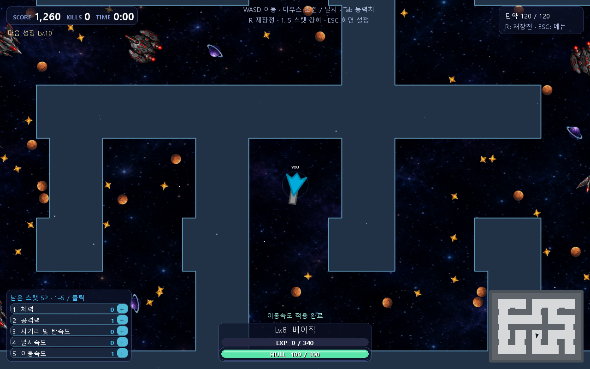

# 성장과 21종 진화

일반 레벨업은 강화 포인트 1개를 주고 사용하지 않으면 누적합니다. 좌하단에 남은 개수가 표시됩니다. 10의 배수는 별도 전직·숙련 보상이며 일반 포인트를 덮어쓰지 않습니다.

| 키 | 이름 | 효과 |
|---|---|---|
| 1 | 체력 | 최대/현재 체력 +25 |
| 2 | 공격력 | 주무기 피해 ×1.25 |
| 3 | 사거리 및 탄속도 | 탄속 ×1.2, 수명 ×1.15 |
| 4 | 발사속도 | 기본 발사 대기 ×0.85, 최소 4프레임 |
| 5 | 이동속도 | 이동 가속도 ×1.15 |

포인트가 0이어도 5개 행을 유지하고 버튼은 비활성화합니다. 발사속도 상한에서는 MAX를 표시하며 포인트를 소모하지 않습니다. 새 게임에서는 초기화합니다.

| Lv10 계열 | Lv20 선택 | Lv30 최종 진화 | 공격 |
|---|---|---|---|
| 트윈 | 듀얼 스트라이커 | 개틀링 스톰 | 교차 2발 → 순차 4발 → 고속 6발 |
| 트윈 | 트리플 윙 | 펜타 윙 | 전방 3방향 → 5방향 동시 |
| 스나이퍼 | 레일거너 | 하이퍼 레일건 | 고속·장거리 일반탄 저격 |
| 스나이퍼 | 헌터 | 프레데터 | 일반 저격탄 단발, 단계별 성능 강화 |
| 플랭크 | 쿼드 윙 | 옥타 스타 | 전후방 → 사방 → 8방향 |
| 플랭크 | 트윈 플랭크 | 헥사 크루저 | 전후 쌍포 → 측면 2포 추가 |
| 가디언 | 바스티온 | 콜로서스 | 큰 선체·체력, 전방 소형 1/2/3포 |
| 가디언 | 이지스 | 시타델 | 큰 방어 선체, 전후방/사방 소형포 |

기본 베이직 1종, Lv10 4종, Lv20 8종, Lv30 8종으로 총 21종입니다. Lv30은 고유 액티브 대신 실제 최종 기체로 진화합니다. Lv40부터 매 10레벨에는 현재 기체 숙련을 선택하며 주무기 피해 배율이 0.2씩 증가합니다.

큰 경험치로 여러 진화 레벨을 지나도 10→20→30 순서대로 고릅니다. 일반 강화와 미사용 포인트는 유지됩니다. 정의는 `progression.py`, 적용은 `game_core.py`에 있습니다.

[맵](04-maps.md) · [목차](../README.md)
