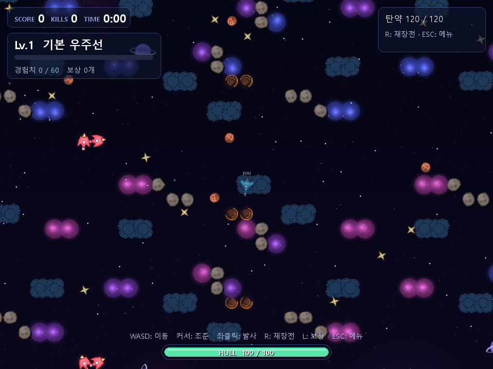
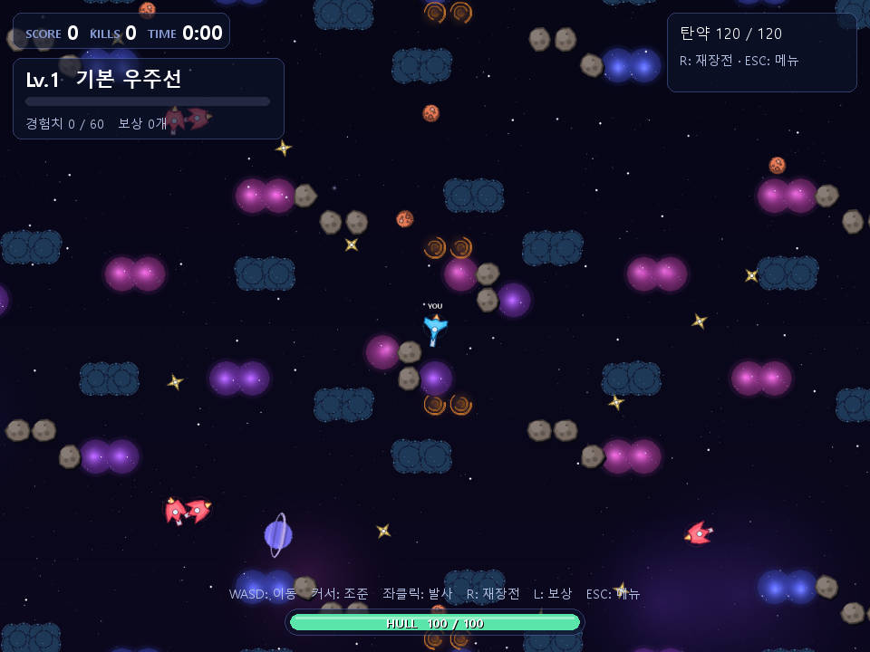
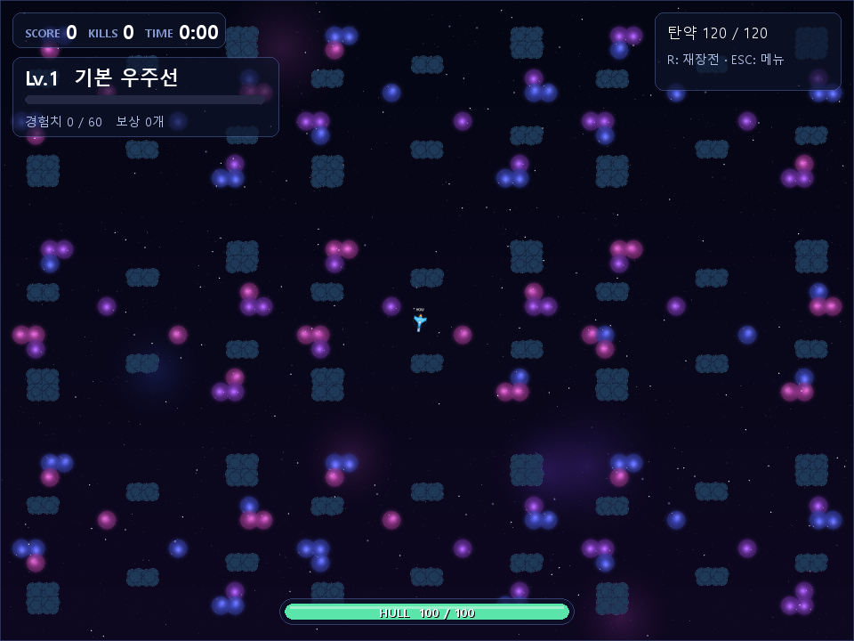
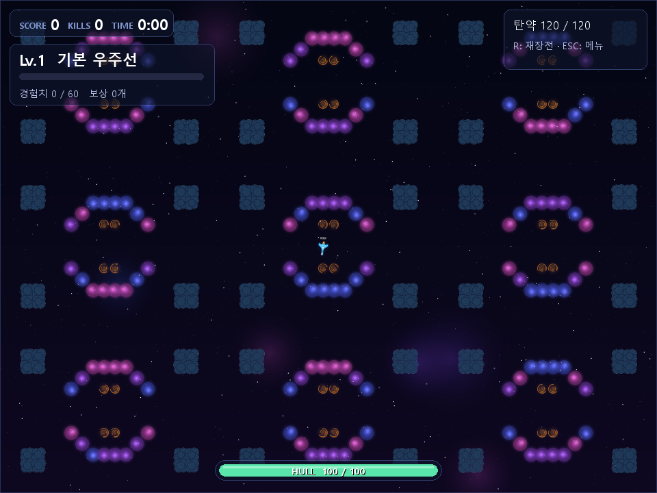
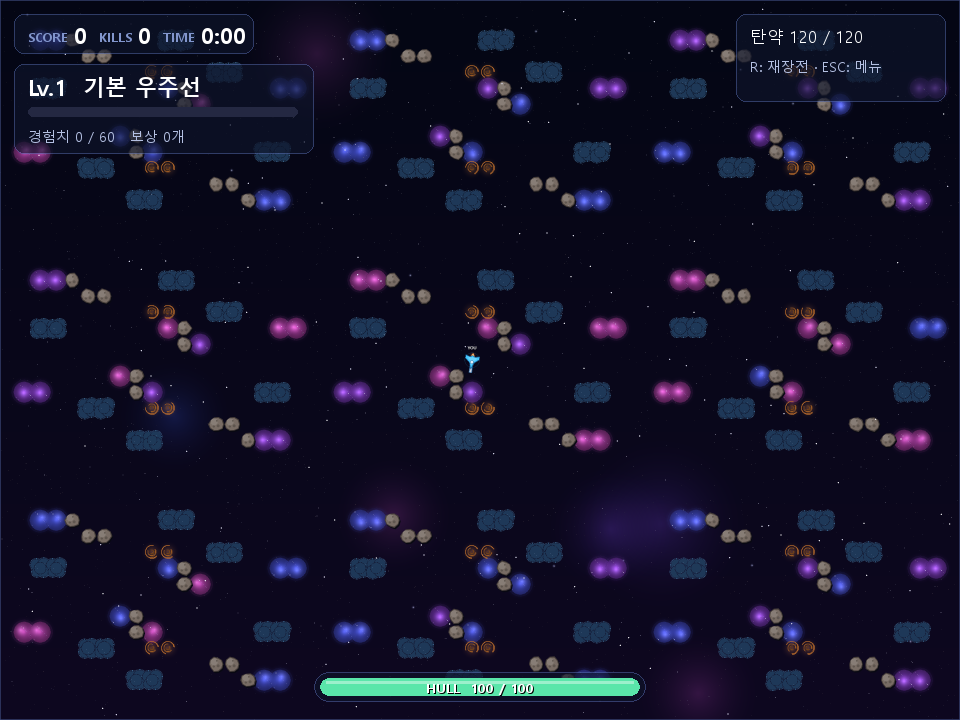
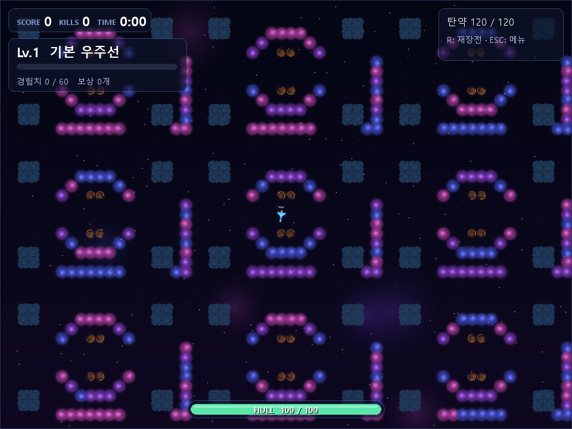

# 맵과 상호작용

맵은 `maps/*.txt`에 적은 타일을 읽어 만듭니다. 기본 템플릿은 **20×15칸, 한 칸 48px**입니다. 같은 템플릿을 가로·세로 3번 반복해 **60×45칸, 2880×2160 월드**로 확장합니다. 타일 자체를 크게 늘리는 방식은 아닙니다.

플레이어는 중앙 구역의 P에서 시작하고, E 위치는 각 반복 구역에 복제됩니다. 랜덤 맵과 빈 우주는 템플릿을 복제하지 않고 월드 전체 크기로 생성합니다.

## 상호작용할 수 있는 지형 전부

| 문자 | 화면 표현 | 상호작용 | 기본 실행 / `--stage2` |
|---|---|---|---|
| `.` | 빈 우주 | 이동·탄환 통과 | 동일 |
| `#` | 성운 | 이동·탄환·시야선 차단. 가장자리를 따라 미끄러져 이동 | 파괴 불가 |
| `*` | 가스 구름 | 들어가면 탱크가 숨음. 이동·탄환은 통과 | 동일 |
| `~` | 중력장 | 가속도를 50%로 줄임. 피해는 없음 | 기본은 빈칸 / stage2는 감속 |
| `+` | 소행성 벽 | 이동·탄환·시야선 차단 | 기본은 파괴 불가 벽 / stage2는 체력 40으로 파괴 가능 |
| `P` | 플레이어 시작 표시 | 스폰 위치 지정. 실제 지형은 빈칸 | 문 하나·회복 장소 등의 기능 없음 |
| `E` | 적 시작 표시 | 적 스폰 후보 지정. 실제 지형은 빈칸 | 플레이어가 이동해 지나갈 수 있음 |

벽에 닿는 것은 피해를 주지 않습니다. 월드 밖으로는 나갈 수 없습니다. 지도 안에서 아이템을 집거나 문을 열거나 별도 상호작용 키를 누르는 기능은 없습니다.

## 가스 구름: 숨기는 하지만 무적은 아님

중심이 구름 타일에 들어간 플레이어는 적 AI의 새 감지 대상에서 빠집니다. 플레이어 자신은 반투명하게 보이고, 구름 안 적은 그림과 체력바가 구름에 가려집니다. 학습 관찰에서도 구름 안 적 탱크는 제외됩니다.

구름은 탄환과 시야선의 물리적 벽이 아닙니다. 이미 날아오는 탄환이나 몸체 접촉으로 피해를 받을 수 있습니다. 적이 마지막 위치를 기억하거나 근처 천체를 향해 쏘는 것도 가능하므로 안전 구역으로 보장되지는 않습니다.

## 중력장과 소행성

중력장은 가속도를 줄이므로 들어가는 즉시 속도가 절반으로 바뀌는 것은 아닙니다. 기존 속도는 관성·마찰에 따라 변합니다. 소행성은 양쪽 탄환으로 피해를 받고, 체력이 0이 되면 빈칸으로 바뀌어 길과 시야가 열립니다. 몸체 접촉으로 벽을 부수는 기능은 없습니다.

파괴된 지형은 그 판에서 유지됩니다. 새 게임에서는 원래 맵을 다시 만듭니다. 소행성을 파괴해도 점수·경험치·아이템을 받지는 않습니다.

## 현재 맵 4개

아래 이미지는 지형 차이를 보기 위한 **확장 월드 전체 화면**입니다. 이 비교에서 중력장·소행성 기능은 모두 켰습니다. 실제 기본 플레이는 60% 줌이고, 해당 지형 기능은 꺼져 있습니다.

### drift: 기본 시작 맵

성운과 구름이 흩어진 열린 배치입니다. 소행성과 중력장은 템플릿에 없습니다. 기본 `map_name`입니다.

### ring: 중앙 고리

P 주변에 성운 고리가 있고 좌우 통로가 열려 있습니다. 귀퉁이에 구름, 중앙 위·아래에 중력장이 있습니다.

### belt: 소행성대

성운·소행성이 대각선으로 흩어져 있고 구름·중력장도 있습니다. 벽 파괴와 감속을 함께 확인할 수 있는 맵입니다. 기본 실행에서는 `+`가 파괴 불가 벽이 됩니다.

### hello-world: 현재 추가된 맵

ring과 유사한 중앙 배치에 오른쪽·아래 벽이 추가되어 있습니다. 현재 파일은 크기와 연결성 검사를 통과합니다. 파일명이 목록에 자동으로 들어가므로 N 순환에도 포함됩니다.

## 맵을 고르는 방법

`python main.py --map belt`처럼 실행 시 선택할 수 있습니다. 게임 화면에서 N을 누르면 **파일명 정렬 순서**로 다음 맵을 선택하고 새 판을 시작합니다.

현재 순환은 `belt → drift → hello-world → ring → 랜덤 맵 → 빈 우주 → belt`입니다. 기본 drift에서 N을 누르면 hello-world로 이동합니다. 메뉴에는 아직 맵 선택 버튼이 없습니다.

`--random-map`은 성운·구름 등을 무작위로 생성하고, `--no-terrain`은 빈 월드를 사용합니다. `--stage2`는 중력장과 파괴 가능 소행성을 함께 켭니다. 지형 기능을 설정 메뉴에서 켜고 끄는 기능은 없습니다.

## 랜덤 맵과 새 맵 작성

랜덤 맵의 기본 밀도 목표는 성운 6%, 구름 5%입니다. stage2에서는 중력장 3%, 소행성 3%도 생성합니다. 덩어리로 배치하고 겹침·연결성 검사를 하므로 실제 비율이 정확히 일치하는 것은 아닙니다. 시작점 주변 3×3칸은 비웁니다.

새 텍스트 맵은 각 줄 20글자, 총 15줄, P 한 개를 사용합니다. `;`로 시작하는 주석과 빈 줄은 크기 계산에서 제외합니다. 허용된 문자와 모든 빈칸의 연결성을 검사하고, 반복 확장한 구역들 사이 연결도 검사합니다. 파일 내용은 실행 중 캐시하므로 수정한 맵을 보려면 프로그램을 다시 실행하는 편이 확실합니다.

## 수정 판단

반복 맵을 유지할지 구역마다 다른 배치를 줄지, 파괴 가능한 벽에 보상을 줄지, 구름을 더 안전한 엄폐로 만들지, 중력장의 감속을 즉시 적용할지 판단할 수 있습니다. 맵 선택과 stage2 옵션을 메뉴에 넣는 것도 현재 사용자 흐름을 바꾸는 지점입니다.

구현 위치: `terrain.py`, `GameCore._make_terrain`, `GameCore.is_hidden`, `GameCore._move_bullets`.

다음: [적 AI와 월드 유지 →](05-enemies-and-world.md) · [목차](../README.md)
